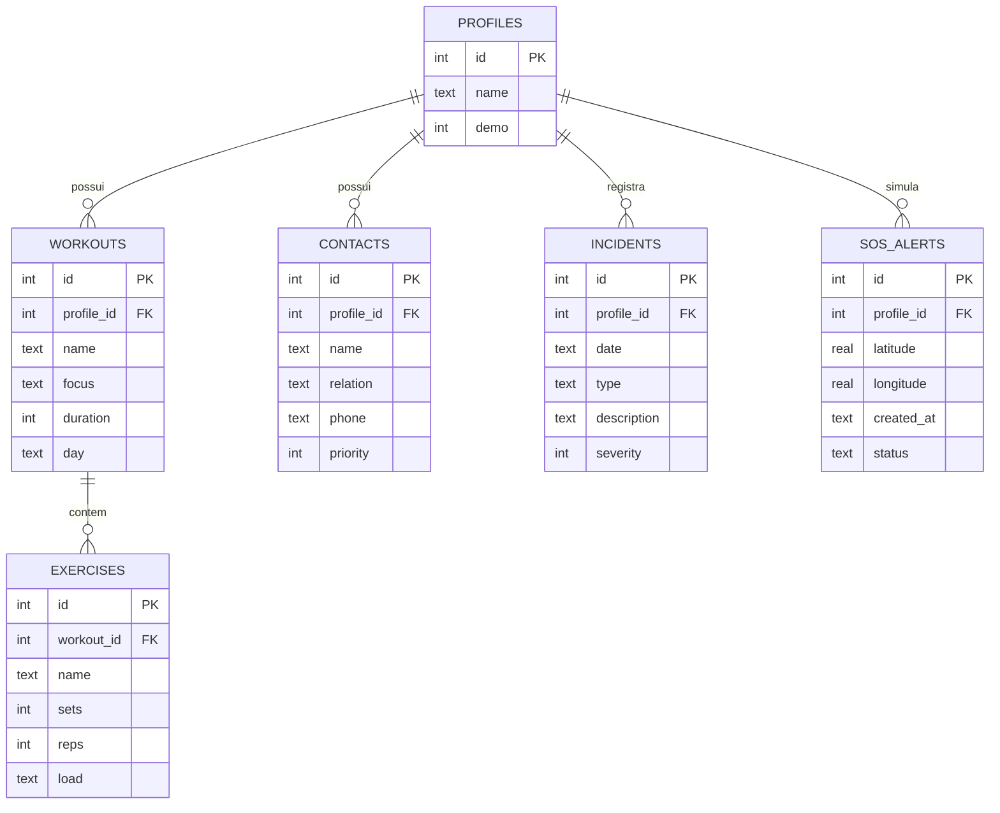

# Modelo de dados real — FitTrack

A aplicação utiliza SQLite (`api/data/fittrack.sqlite`) por `node:sqlite`, com integridade de chave estrangeira ativada (`PRAGMA foreign_keys=ON`). Não se trata de arrays/mockData no aplicativo.

## Relacionamento obrigatório

- `exercises.workout_id` referencia `workouts.id`, com **`ON DELETE CASCADE`**.
- A API rejeita um exercício vinculado a treino inexistente com **HTTP 422**.
- `incidents.profile_id` referencia `profiles.id`: **Ocorrências é uma entidade/tabela própria**, distinta de Contatos, Treinos e Exercícios; esse é o CRUD atribuído ao **Luhan**.
- A conta padrão `profiles.id=1` é **apenas demonstrativa**, sem autenticação/isolamento de usuários. Não usar registros reais de vítimas.
